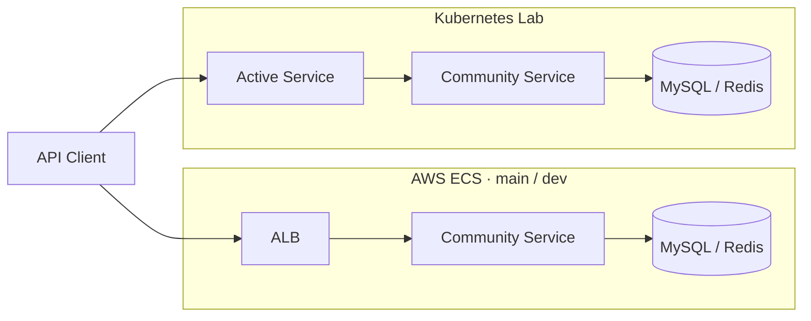

# 🍔 Burgerpedia

**취향에 맞는 햄버거를 찾고, 다른 사람들과 버거에 대한 경험을 나누는 검색·리뷰 커뮤니티입니다.**

## Project Overview

버거피디아는 브랜드에 관계없이 메뉴를 탐색하고, 가격과 평점, 맛과 식감에 대한 사용자 평가를 참고할 수 있도록 기획한 서비스입니다. 사용자는 자신의 취향에 맞는 버거를 찾고, 직접 경험한 메뉴에 대한 리뷰를 공유할 수 있습니다.

이 저장소는 버거피디아의 메뉴 검색과 리뷰 커뮤니티 기능을 제공하는 백엔드 서비스입니다. 서비스 개발과 함께 검색 성능, 배포 자동화, 서비스 안정성을 검증하는 개인 프로젝트로 진행하고 있습니다.

## Features

> **User Journey** : 메뉴 탐색 → 리뷰와 평점 확인 → 메뉴 선택 → 리뷰 작성 → 경험 공유

| 기능 | 설명 |
| --- | --- |
| 브랜드·메뉴 탐색 | 브랜드별 메뉴 정보를 조회하고 키워드, 브랜드, 가격을 기준으로 검색할 수 있습니다. |
| 버거 리뷰 | 메뉴별 리뷰를 작성하고 1~5점 평점, 맛과 식감에 대한 평가 태그, 사진을 남길 수 있습니다. |
| 통합 검색 | 메뉴명, 브랜드명, 리뷰 제목·본문, 평가 태그를 검색하고 메뉴와 리뷰를 함께 확인할 수 있습니다. |
| 커뮤니티 | 댓글과 좋아요를 통해 다른 사용자의 리뷰에 반응하고 경험을 공유할 수 있습니다. |

## Architecture

동일한 커뮤니티 서비스를 두 개의 독립된 환경에서 구성하여 부하 테스트와 배포 안정성을 검증합니다.

| 환경 | 배포 경로 | 목적 |
| --- | --- | --- |
| AWS ECS | GitHub Actions → ECR → CodeDeploy | main/dev 분리, API 부하 테스트 및 Blue-Green 배포 |
| Kubernetes Lab | GitHub Actions → GHCR → GitOps → Argo CD / Argo Rollouts | 승격 전 API 검증 및 Prometheus 오류율 기반 롤백 실습 |

다이어그램은 서비스 요청 경로를 중심으로 단순화했습니다. ECS의 main/dev는 각각 독립된 애플리케이션과 데이터 저장소를 사용하며, Kubernetes Lab은 별도 실습 환경입니다. 세부 배포 및 모니터링 구성은 관련 저장소를 참고할 수 있습니다.

기술적 의사결정 및 실험 과정은 [기술 블로그](https://velog.io/@xezixx/posts)에 기록합니다. 배포 환경의 상세 설정은 [DEPLOYMENT.md](DEPLOYMENT.md)를 참고할 수 있습니다.
